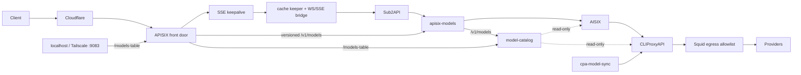

# AI Gateway

> [!IMPORTANT]
> You can use this project exactly as it is, but consider it merely a starting point—your imagination will surely enable you to create something even better than what I have built.
> This project is also my protest against the proliferation of AI gateways that lack any standardization.
>
> 这个项目你可以原样使用，也是抛砖引玉，你的想象力一定能创造比我更美好的东西。此外本项目是我对于 AI 网关满天飞但是却毫不规范的抗议。

A reusable Docker Compose stack that builds a self-owned AI gateway from separate modules: [CLIProxyAPI](https://github.com/router-for-me/CLIProxyAPI), [Sub2API](https://github.com/Wei-Shaw/sub2api), [AISIX](https://github.com/api7/aisix), [Apache APISIX](https://apisix.apache.org/), [ai-sse-keepalive-proxy](https://github.com/xz-dev/ai-sse-keepalive-proxy), [openai-api-cache-keeper](https://github.com/xz-dev/openai-api-cache-keeper), [Squid](https://www.squid-cache.org/), [socat](http://www.dest-unreach.org/socat/) and [Cloudflare Tunnel](https://developers.cloudflare.com/cloudflare-one/networks/connectors/cloudflare-tunnel/). Each module keeps one job: provider credentials, client API keys, logical-model routing, public routing and Internet ingress stay separate. Components are cleanly separated and no script hides the configuration, so an AI agent can deploy and change it while a human reviews it.



Full graph: [docs/architecture.md](docs/architecture.md).

> [!WARNING]
> Every intentionally public host port needs an external firewall or cloud security group. Tracked defaults bind host ports to `127.0.0.1`; never change a `*_BIND_ADDRESS` to `0.0.0.0`. See [docs/security.md](docs/security.md).

## Components

All components live under [`services/`](services/README.md), grouped by role; operations tooling lives under [`ops/`](ops/).

| Component | Where | What it does | How to use |
|---|---|---|---|
| Cloudflare Tunnel | service `cloudflared` | Internet ingress to the front APISIX | Public Hostname origin `http://apisix-ingress:9080` ([installation](docs/installation.md#cloudflare-tunnel)) |
| APISIX front door | [`services/firewall/apisix/`](services/firewall/apisix/README.md), `127.0.0.1:9080`; operator `9083` | Public AI route allowlist, limits, opaque `404`; catalog intersection; models table on `9083` | [Public API](docs/public-api.md), [catalog path](docs/catalog.md) |
| Egress proxy | [`services/firewall/egress-proxy/`](services/firewall/egress-proxy/README.md) | Fail-closed Squid allowlist; the only Internet egress | Edit `data/egress-proxy/policy.json` ([egress policy](docs/egress-policy.md)) |
| One-way relays | [`services/firewall/one-way-relay/`](services/firewall/one-way-relay/README.md) | socat relays and namespace owners for every directed edge | [Security model](docs/security.md) |
| AI SSE keepalive proxy | [`services/middleware/ai-sse-keepalive-proxy/`](services/middleware/README.md), optional operator lane `127.0.0.1:8087` | Heartbeats for silent AI SSE streams | No configuration |
| Cache keeper + WS/SSE bridge | [`services/middleware/`](services/middleware/README.md) | Responses history, background replay, WebSocket → HTTP/SSE | [Responses path](docs/responses-path.md) |
| Sub2API | [`services/sub2api/`](services/sub2api/README.md), admin `127.0.0.1:8086` | The only client API-key, entitlement and quota authority | [Upstream configuration](docs/upstream-configuration.md) |
| apisix-models | [`services/routing/apisix-models/`](services/routing/apisix-models/README.md), no host port | Constant pipe: `/v1/models` → model-catalog, everything else → AISIX | [Model routing](docs/model-routing.md) |
| AISIX + status page | [`services/routing/aisix/`](services/routing/aisix/README.md), [`aisix-status/`](services/routing/aisix-status/README.md); `127.0.0.1:3001/status` | Logical model IDs, ordered fallback, cooldown; no-JS status page | [Upstream configuration](docs/upstream-configuration.md) |
| model-catalog | [`services/routing/model-catalog/`](services/routing/model-catalog/README.md) | Codex model catalog and `/models-table`; reads CPA and AISIX read-only | [model-catalog reference](docs/model-catalog.md) |
| CLIProxyAPI (CPA) | [`services/cpa/config/`](services/cpa/config/README.md), `127.0.0.1:8317` | Provider credentials and pool execution | Management UI with `CPA_MANAGEMENT_KEY` |
| cpa-model-sync | [`services/cpa/cpa-model-sync/`](services/cpa/cpa-model-sync/README.md) | Syncs model membership of five CPA API-key channel kinds | Its README |
| provider-sidecar (optional) | private `compose.override.yaml` | OpenAI-compatible sidecar behind TLS relay and tunnel | [Provider sidecar](docs/provider-sidecar.md) |
| Ansible ops | [`ops/ansible/`](ops/ansible/README.md) | Guarded plan/apply deploys and rollbacks to the host | [Ansible operations](docs/ansible-operations.md) |
| Scripts | [`ops/scripts/`](ops/scripts/README.md) | Init, validate, render, host recovery and tests | [Operations](docs/operations.md) |

## Quick start

Requirements: Linux with `/dev/net/tun`, Docker Engine with Compose v2.33.1+ or rootless Podman with a Compose provider, OpenSSL, and a remotely managed Cloudflare Tunnel.

```bash
git clone --recurse-submodules https://github.com/xz-dev/AI-gateway.git "$HOME/AI-gateway"
cd "$HOME/AI-gateway"
./ops/scripts/init.sh                 # private .env, CPA and AISIX files (never overwrites)
# edit .env (ADMIN_EMAIL, CLOUDFLARED_TUNNEL_TOKEN) and services/routing/aisix/resources.yaml
./ops/scripts/init-egress-proxy.sh    # render data/egress-proxy/policy.json
./ops/scripts/validate.sh
source ./ops/scripts/container-runtime.sh
"${AI_GATEWAY_COMPOSE[@]}" up -d --build
```

Full steps: [docs/installation.md](docs/installation.md). Day-2 operations: [docs/operations.md](docs/operations.md).

## Documentation

Guides and reference:

- Agent workflows: [deploy, update and operate](.agents/skills/ai-gateway-ops/SKILL.md); [Sub2API business settings](.agents/skills/sub2api-ops/SKILL.md)
- [Architecture](docs/architecture.md) — full component graph
- [Installation](docs/installation.md) — first install and Cloudflare Tunnel
- [Security model](docs/security.md) — boundaries, one-way edges, hardening
- [Egress policy](docs/egress-policy.md) — Squid allowlist rules
- [Upstream configuration](docs/upstream-configuration.md) — CPA, AISIX and Sub2API wiring
- [Responses path](docs/responses-path.md) — Pi Codex transports and cache keeper
- [WebSocket termination](docs/websocket-termination.md) — topology decision and limits
- [Model routing](docs/model-routing.md) — constant pipe, AISIX-first fallback and deploy checklist
- [Provider sidecar](docs/provider-sidecar.md) — optional sidecar role
- [Public API behavior](docs/public-api.md) — routes and opaque responses
- [Operations and validation](docs/operations.md) — coupled stack, state, `validate.sh`
- [Gateway health and recovery](docs/gateway-health-and-recovery.md) — readiness and bounded recovery
- [Ansible operations](docs/ansible-operations.md) — playbook tags, variables, guarded rollouts
- [model-catalog](docs/model-catalog.md) — catalog service reference
- [Model catalog path](docs/catalog.md) — front-door intersection and models table
- [Models table scheduled refresh](docs/models-table-scheduled-refresh.md)
- [Add an OpenAI-compatible provider](docs/add-openai-compatible-provider.md)
- [Sub2API error passthrough](docs/sub2api-error-passthrough-configuration.md)
- [Sub2API Codex manifest defects](docs/sub2api-codex-manifest-implementation-defects.md)
- [Repository layout](docs/layout.md) — `services/` and `ops/` tree

Verification evidence: [catalog identity](docs/records/catalog-identity-verification.md), [layered metadata](docs/records/layered-metadata-verification.md) ([deployment](docs/records/layered-metadata-deployment.md)), [output-token fields](docs/records/output-token-field-semantics-verification.md), [models-table SSR](docs/records/models-table-ssr-verification.md), [Go enricher read cache (historical)](docs/records/enricher-read-cache-verification.md), [Go provider prefix (historical)](docs/records/enricher-provider-prefix.md), [catalog round closeout](docs/records/catalog-round-closeout.md).

Dated deployment records (point-in-time, not current state): [2026-09-07 CPA](docs/records/cpa-v7.2.153-deployment-2026-09-07.md), [2026-09-07 read cache](docs/records/enricher-read-cache-deployment-2026-09-07.md), [2026-09-08 bare chain](docs/records/enricher-bare-chain-deployment-2026-09-08.md), [2026-09-08 positive admission](docs/records/catalog-positive-admission-deployment-2026-09-08.md), [2026-09-08 provider prefix](docs/records/enricher-provider-prefix-deployment-2026-09-08.md), [2026-09-08 models-table SSR](docs/records/models-table-ssr-deployment-2026-09-08.md), [2026-09-08 output-token fields](docs/records/output-token-field-deployment-2026-09-08.md), [2026-09-08 source chain](docs/records/source-chain-deployment-2026-09-08.md), [2026-09-15 aihub](docs/records/aihub-provider-deployment-2026-09-15.md), [2026-09-16 force refresh](docs/records/models-table-force-refresh-deployment-2026-09-16.md), [2026-09-30 tunnel 103](docs/records/cloudflare-tunnel-103-diagnosis-2026-09-30.md), [2026-09-30 keepalive late error](docs/records/keepalive-late-error-deployment-2026-09-30.md), [2026-10-01 header wait](docs/records/keepalive-header-wait-10s-deployment-2026-10-01.md), [2026-10-09 upgrades](docs/records/component-upgrade-2026-10-09.md) ([round 2](docs/records/component-upgrade-2026-10-09-round2.md)), [2026-10-09 memory/swap](docs/records/memory-swap-2026-10-09.md), [2026-10-11 upgrades](docs/records/component-upgrade-2026-10-11.md), [2026-10-12 CPA](docs/records/cpa-upgrade-2026-10-12.md), [2026-10-15 upgrades](docs/records/component-upgrade-2026-10-15.md), [2026-10-20 one-way edges](docs/records/one-way-edges-deployment-2026-10-20.md), [2026-10-23 batch](docs/records/deployment-batch-20261023.md).

## License

This deployment template is licensed under the [MIT License](LICENSE). Container images and upstream applications retain their own licenses.
