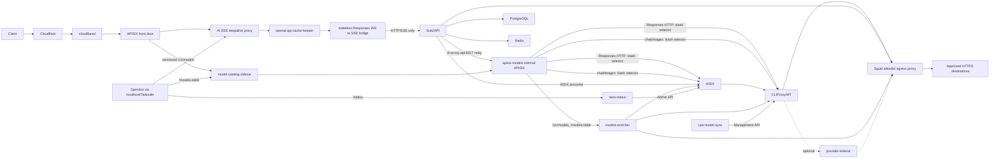

# AI Gateway

> [!IMPORTANT]
> You can use this project exactly as it is, but consider it merely a starting point—your imagination will surely enable you to create something even better than what I have built.
> 
> Furthermore, this project serves as my protest against the proliferation of AI gateways that lack any standardization.
>
> 这个项目你可以原样使用，也是抛砖引玉，你的想象力一定能创造比我更美好的东西
> 
> 此外本项目是我对于 AI 网关满天飞但是却毫不规范的抗议

> [!IMPORTANT]
> This project lets you build an AI gateway that is entirely your own, one module at a time. The architecture combines the strengths of each module and covers their weaknesses, so you are not limited by any single gateway or component, and you do not need large-scale custom development.

> [!NOTE]
> Have an AI deploy this project for you. Its maintainability relies on AI-native development:
>
> 1. Components are cleanly separated, so humans can easily review the architecture and check that the configuration is correct.
> 2. No automated deployment script hides or unifies the complexity of the configuration files. Let an AI make configuration changes for you, so that nothing is changed incorrectly or missed.

Model inventory synchronization: [cpa-model-sync usage and policy migration](cpa-model-sync/README.md).
The Rust sidecar manages only the five supported API-key kinds through CPA's internal
Management API. Gemini/Interactions retain their existing inventory behavior; models-enricher metadata,
OAuth/native visibility, static aliases and downstream authorization remain separate.

Reusable Docker Compose stack for [CLIProxyAPI](https://github.com/router-for-me/CLIProxyAPI), [Sub2API](https://github.com/Wei-Shaw/sub2api), [AISIX](https://github.com/api7/aisix), [Apache APISIX](https://apisix.apache.org/), [ai-sse-keepalive-proxy](https://github.com/xz-dev/ai-sse-keepalive-proxy), [openai-api-cache-keeper](https://github.com/xz-dev/openai-api-cache-keeper), [Squid](https://www.squid-cache.org/), [socat](http://www.dest-unreach.org/socat/), and [Cloudflare Tunnel](https://developers.cloudflare.com/cloudflare-one/networks/connectors/cloudflare-tunnel/).

It separates provider credentials, client API-key authority, logical-model routing, public routing, and Internet ingress:



> [!WARNING]
> **An external firewall or cloud security group is a deployment prerequisite for every intentionally public host port.** The tracked defaults bind host-published ports to `127.0.0.1`. If that external boundary is unavailable, keep every `*_BIND_ADDRESS` on loopback or a specific trusted interface and never change it to `0.0.0.0`. Container-internal listeners do not make a host port public; Compose `ports` bindings do.

## Security model

- **Sub2API is the only client API-key authority.** APISIX never validates client keys.
- APISIX exposes an AI-method/path allowlist. Management, login, health, and unknown routes are not public.
- `ai-sse-keepalive-proxy` is AI SSE protocol-specific, not a generic arbitrary-SSE transformer. It recognizes streaming OpenAI Responses, OpenAI Chat Completions, and Anthropic Messages framing. Placement after APISIX lets APISIX remain sole public security boundary while proxy owns parser-visible startup/idle writes during silent upstream periods.
- APISIX reaches middleware only through `apisix-ai-sse-relay`; middleware reaches Sub2API only through `ai-sse-sub2api-relay`. APISIX and Sub2API share no network. Sub2API trusts forwarded IP headers only from outgoing relay target `172.30.26.3/32`, preserving APISIX-sanitized forwarding headers through middleware.
- APISIX keys limits on each resolved real client IP: 10 requests/second with a 40-request burst, at most 50 concurrent requests, and a hard 300 requests per 60-second local window. Excess traffic receives an immediate neutral `429`; the long-window limit cannot degrade open and emits no quota headers.
- Request bodies are capped at 16 MiB and rejected with a neutral `413` before reaching Sub2API.
- Public final `401` and all final `404` responses become the same zero-byte `404`; other statuses and successful, SSE, and WebSocket responses remain transparent.
- APISIX strips Sub2API's private `X-Client-Request-ID` and preserves standard `X-Request-ID` on non-opaque responses.
- Sub2API accepts forwarded client IPs only through AI SSE middleware's outgoing relay, after APISIX sanitizes them. Its URL allowlist stays disabled because AISIX and CPA use internal HTTP URLs; Docker pairwise networks provide the service-reachability boundary instead.
- AISIX exclusively owns client-visible logical model IDs, ordered fallback, bounded retries, and per-concrete-target cooldown. CPA retains provider credentials and pool execution; Sub2API retains client authentication, entitlement and quota; it receives only HTTP/SSE because WebSocket ends at the front keeper and stateless bridge.
- CPA, Sub2API admin access, and APISIX bind to loopback by default. AISIX Admin binds only to the dedicated unpublished `aisix-status-admin` network. The separate server-rendered `/status` page binds to loopback by default and may additionally bind to one explicit Tailscale address, never a wildcard.
- The unauthenticated model diagnostics page on host port `9083` may publish only on loopback or an explicit Tailscale address. Validation checks the effective merged Compose configuration and rejects omitted host addresses, IPv4/IPv6 wildcards, and public IP bindings; failed public-IP probes are not evidence of a private binding.
- Every directed TCP edge, including all four AISIX edges (`sub2api-aisix`, `enricher-aisix`, `apisix-models-aisix`, `aisix-cpa`), uses an independent explicit-version `alpine/socat` relay between disjoint `*-source` and `*-target` internal networks. A Docker network itself has no direction; direction comes from who listens where. Every relay therefore binds only its own source-side address (`bind=`). AISIX proxy binds its three relay-target addresses, AISIX Admin and metrics bind `aisix-status-admin`, both APISIX data planes bind their relay targets plus loopback with the default TLS listener disabled, and the catalog bridge binds its source address. Other applications, including Sub2API and the enricher, still have wildcard listeners inside their route-stripped namespaces. The separated networks and relay bindings block the target from initiating a new connection across the relay toward the source application; established TCP connections remain bidirectional.
- Residual trust: a relay can reach listeners on its target network and any listener its source-side peer exposes on their shared source network. Relays run as `65534`, read-only and without capabilities; the CPA host relay uses a fixed shell supervision loop, so absence of a shell is not a blanket guarantee.
- `openai-api-cache-keeper` shares the keepalive namespace, listens only on `127.0.0.1:8085`, publishes no port, and reaches Sub2API through the stateless loopback WS bridge (`127.0.0.1:8086`) and existing one-way relay. The bridge has its own bounded disk spool volume, no published port, and the same non-root/read-only capability restrictions. It runs as `65534:65534` with a read-only root, no capabilities and `no-new-privileges`; only its disposable disk volume is writable. Local cached reads/cancellation revalidate the caller through Sub2API's billing endpoint and fail closed. Operator bypasses public filtering, never API authentication.
- Every internal network has an explicit bounded membership; no service uses Compose's default network. CPA, Sub2API, APISIX, AISIX, and AI SSE middleware share networking with minimal Alpine namespace owners that delete all default routes and drop privilege. Separate host-ingress namespace owners hold published ports and the source/target sides of socat-relayed edges. This remains portable across rootless Podman and rootful Docker without host firewall changes or engine-specific bridge options.
- CPA and Sub2API have no direct Internet route. Each reaches Squid only through its own source/target socat relay pair. AISIX has no Internet or Squid edge at all. Its configured application egress reaches CPA through `aisix-cpa-relay`; its three inbound relay edges do not provide reverse initiation into Sub2API, the enricher or `apisix-models`. Admin and metrics remain on the private status network. Squid alone joins `proxy-egress`; cloudflared alone joins its egress network and reaches APISIX only through its own relay. APISIX has no Internet route.
- An optional `provider-sidecar` stays out of the reusable base Compose file. This is a generic role for an explicit-version OpenAI-compatible service whose runtime-specific image, environment, mounts, command, healthcheck, domains, models, and credentials exist only in ignored production state. The generated override supplies reusable TLS, shared-TUN, virtual-DNS, relay, and Squid boundaries without naming or embedding a concrete provider.
- Egress policy is fail-closed. Every HTTPS tunnel must pass service/source, CONNECT domain, exact ClientHello SNI-to-CONNECT matching, and resolved private/reserved-address denial. Squid resolves only through an in-container Unbound instance that forwards over DNS-over-TLS to Cloudflare and Google (so those resolvers see egress hostnames) and strips unsafe answers before caching, including mixed and rebinding responses. `bump` destinations additionally require exact decrypted Host-to-SNI matching plus method/path ACLs. `splice` destinations retain end-to-end TLS fingerprints but cannot expose encrypted Host/path to Squid.
- TLS inspection uses a locally generated CA. Its private key is mounted only into Squid; CPA, Sub2API, and optional provider-sidecar receive only a public trust bundle. Upstream certificate validation remains enabled.
- Every image uses an explicit non-floating version tag, optionally with a SHA-256 digest pin; `latest` is rejected by validation. Every container has PID, memory, CPU, capability, and log-size bounds. Root filesystems are read-only where runtime evidence showed no required overlay writes; APISIX and Sub2API retain writable roots for generated configuration and request handling.
- Cloudflare Tunnel receives its token from the ignored mode-`0600` `.env`, never from tracked Compose or config files.

Production rollout and bounded live checks: [2026-10-20 one-way edges deployment](docs/one-way-edges-deployment-2026-10-20.md).

## Quick start

Requirements: Linux with `/dev/net/tun`, either Docker Engine with Compose v2.33.1+ or rootless Podman with a Compose provider, OpenSSL, and a remotely managed Cloudflare Tunnel. Scripts automatically select a running Docker or Podman engine; no `docker` compatibility shim is required. The same Compose uses only container-local shared namespaces, temporary route-setup capabilities, virtual DNS, and the TUN device; it never changes host firewall or routing state.

```bash
git clone --recurse-submodules https://github.com/xz-dev/AI-gateway.git "$HOME/AI-gateway"
cd "$HOME/AI-gateway"
./scripts/init.sh
```

`init.sh` generates private values without printing them. It refuses to overwrite an existing `.env`, CPA config, or AISIX runtime file. It creates `aisix/config.yaml` and `aisix/resources.yaml` behind a mode-`0700` directory, plus mode-`0600` `aisix/caller-keys.json` for operator use.

1. Replace `ADMIN_EMAIL=admin@example.invalid` in `.env`.
2. In Cloudflare Dashboard, create a remotely managed Tunnel and replace `CLOUDFLARED_TUNNEL_TOKEN` in `.env` using an editor that does not expose it in shell history. Keep `.env` mode `0600`.
3. Replace the example model entries in private `aisix/resources.yaml` with the approved concrete CPA targets and logical routes. Keep one CPA provider key, reuse each concrete target as one direct model, and give Sub2API only the logical IDs it is authorized to expose. Configure CPA-backed Sub2API accounts with Base URL `http://cli-proxy-api:8317/v1` (the relay to the inner models gateway), the private `sub2api` caller key from `aisix/caller-keys.json`, boolean pool mode, bounded retry, and account WS mode `off` after the front bridge is live. Never print either caller key.
4. Review the built-in control-plane rules in `data/egress-proxy/policy.json`, add only the deployment-specific provider or optional-feature destinations you need, then render it. This ignored runtime file is created only when absent, so repository upgrades never merge into or replace the user's allowlist:

   ```bash
   ./scripts/init-egress-proxy.sh
   ```

   The generated policy allows only the exact CPA and Sub2API control-plane `GET` requests documented below; provider, OAuth, plugin, private-sidecar, and user-defined egress remains denied. Use `tls: "bump"` with explicit methods and anchored POSIX path expressions. Use `tls: "splice"` only when preserving end-to-end TLS behavior is required; splice entries cannot enforce HTTP Host/path.
5. If production uses an optional provider-sidecar, add an explicit non-floating version-tagged `PROVIDER_SIDECAR_IMAGE`, non-root `PROVIDER_SIDECAR_USER`, and `PROVIDER_SIDECAR_API_KEY` only to the ignored `.env`. Initialize dedicated internal TLS, generate the ignored transport override, then add the image-specific environment, mounts, command, and healthcheck to that private override:

   ```bash
   ./scripts/init-provider-sidecar-tls.sh
   ./scripts/init-provider-sidecar-override.sh
   ```

   The public contract is intentionally narrow: the sidecar is OpenAI-compatible at `/v1`, listens on plain HTTP port `8080` inside its shared tunnel namespace, publishes no host port, runs as the declared non-root user, and obtains all Internet access through TUN → relay → Squid. The generator does not know or store any vendor-specific runtime setting.

6. Validate and start. AISIX uses the official `ghcr.io/api7/aisix` release; GitHub Actions publishes the independent status image to GHCR from its tracked Dockerfile. Compose consumes fixed version tags and never compiles them on the production host; ai-sse-keepalive-proxy and models-enricher remain local builds:

   ```bash
   git submodule update --init --recursive
   ./scripts/validate.sh
   source ./scripts/container-runtime.sh
   "${AI_GATEWAY_COMPOSE[@]}" pull cli-proxy-api postgres redis sub2api aisix aisix-status apisix cloudflared
   "${AI_GATEWAY_COMPOSE[@]}" up -d --build
   "${AI_GATEWAY_COMPOSE[@]}" ps
   ```

   Do not rely on `--wait`: rootless Podman installations without automatic healthcheck scheduling (for example OpenRC) may leave health at `starting`. `./scripts/validate.sh` performs explicit runtime probes instead of relying on engine health timers.

## Cloudflare Tunnel

Create a Public Hostname in Cloudflare Dashboard with this origin service:

```text
http://apisix-ingress:9080
```

Do not point the Tunnel directly at Sub2API or CPA. Configure a Cache Rule that bypasses cache for the API hostname. Cloudflare-side changes remain operator-owned; this repository stores no account ID, tunnel ID, hostname, or token.

The Compose service uses Cloudflare's supported `TUNNEL_TOKEN` environment variable. This is portable across Docker Compose implementations and avoids an unreadable UID-mismatched file secret. Docker daemon administrators can inspect container environments, so protect daemon access as root-equivalent. No local `cloudflared` ingress file is needed because hostname routing is managed in Cloudflare Dashboard.

## Configure egress policy

Fresh installations start with a control-plane-only policy. Every entry below is enabled for the named service, uses `GET` with `tls: "bump"`, and matches only the listed domain and JSON path expression:

| Service | Component | Exact domain | Anchored path |
|---|---|---|---|
| CPA | Core version check | `api.github.com` | `^/repos/router-for-me/CLIProxyAPI/releases/latest$` |
| CPA | Management Center release metadata | `api.github.com` | `^/repos/router-for-me/Cli-Proxy-API-Management-Center/releases/latest$` |
| CPA | Management Center browser download | `github.com` | `^/router-for-me/Cli-Proxy-API-Management-Center/releases/download/[^/]+/management\\.html$` |
| CPA | Management Center release asset | `release-assets.githubusercontent.com` | `^/github-production-release-asset/1051566067/` |
| CPA | Model catalog | `raw.githubusercontent.com` | `^/router-for-me/models/refs/heads/main/models\\.json$` |
| CPA | Codex client model catalog | `raw.githubusercontent.com` | `^/router-for-me/models/refs/heads/main/codex_client_models\\.json$` |
| Sub2API | Core version check | `api.github.com` | `^/repos/Wei-Shaw/sub2api/releases/latest$` |
| Sub2API | Codex latest release | `api.github.com` | `^/repos/openai/codex/releases/latest$` |
| Sub2API | Codex stable-release fallback | `api.github.com` | `^/repos/openai/codex/releases\\?per_page=30$` |
| Sub2API | Claude Code latest release | `api.github.com` | `^/repos/anthropics/claude-code/releases/latest$` |
| Sub2API | Claude Code stable-release fallback | `api.github.com` | `^/repos/anthropics/claude-code/releases\\?per_page=30$` |
| Sub2API | Pricing data | `raw.githubusercontent.com` | `^/Wei-Shaw/model-price-repo/main/model_prices_and_context_window\\.json$` |
| Sub2API | Pricing hash | `raw.githubusercontent.com` | `^/Wei-Shaw/model-price-repo/main/model_prices_and_context_window\\.sha256$` |

The Management Center flow needs all three download hosts. Its final GitHub URL contains a release-specific asset identifier and signed query, so the policy pins only the start-anchored repository-ID prefix; never copy signed redirect queries into policy, documentation, or logs.

Provider destinations remain deployment-specific. Example bumped provider rule:

```json
{
  "domain": "api.openai.com",
  "tls": "bump",
  "methods": ["POST"],
  "paths": ["^/v1/(responses|chat/completions|embeddings)($|[?])"]
}
```

Example TLS-preserving destination:

```json
{
  "domain": "subscription.example.com",
  "tls": "splice"
}
```

The tracked default does not authorize provider inference. `models-enricher` has no internet egress: models.dev and modelparams.dev data come from exactly pinned npm snapshots (`@opencode-ai/models`, `modelparams`) converted at image build time and bumped by an hourly Dependabot entry, and channel upstream data comes through CPA `api-call`. Optional components need separate exact rules:

| Component | Exact domain | Anchored path |
|---|---|---|
| Sub2API rollback-version listing | `api.github.com` | `^/repos/Wei-Shaw/sub2api/releases\\?per_page=15$` |
| CPA plugin registry, listing only | `raw.githubusercontent.com` | `^/router-for-me/CLIProxyAPI-Plugins-Store/main/registry\\.json$` |
| CPA model-catalog fallback | `models.router-for.me` | `^/models\\.json$` |
| CPA Codex-catalog fallback | `models.router-for.me` | `^/codex_client_models\\.json$` |

Plugin registry access does not authorize plugin installation. Add each deliberately installed plugin's exact GitHub release API path, repository-specific browser download path, and numeric `release-assets.githubusercontent.com` repository-ID prefix. Never use an owner, repository, release-path, or repository-ID wildcard. Do not enable `cpamc.router-for.me` by default: CPA identifies that fallback Management Center page as lacking release digest verification.

Provider inference and OAuth, GitHub user-profile APIs, backup, payment, webhook, private override, and local ZCode destinations remain operator-owned. Sub2API's default latest-release rule provides version awareness only; upgrade the pinned `SUB2API_IMAGE` and recreate the coupled stack instead of allowing in-container binary, checksum, or rollback asset downloads.

Repository upgrades do not modify an existing `data/egress-proxy/policy.json`. Existing installations must compare it with `egress-proxy/policy.example.json`, manually merge only desired exact rules, run `./scripts/init-egress-proxy.sh`, and validate before recreating Squid with its dependent clients.

Domain entries may be exact names or start with `.` to include subdomains. A domain may have multiple `bump` entries when different paths require different methods, but it cannot mix `bump` and `splice`. IP literals, plaintext HTTP, missing SNI, CONNECT ports other than 443, unlisted redirects, unknown methods/paths, private/link-local/loopback/CGNAT/documentation/multicast/reserved destinations, and malformed upstream certificates fail closed. Never allow all of GitHub: add only the exact repository API, raw-content, or release paths a configured component actually reads. Re-run `./scripts/init-egress-proxy.sh` after every policy edit, then validate and recreate Squid with its dependent clients together.

## Configure AISIX, CPA, and Sub2API

CPA listens at `http://127.0.0.1:8317` by default. Its management UI/API requires the private `CPA_MANAGEMENT_KEY` stored in `.env`. OAuth callback ports are also loopback-only. Use SSH port forwarding rather than changing them to `0.0.0.0` on a remote host.

CPA's global `proxy-url` forces provider transports through Squid. If an OpenAI-compatible entry targets another service on a pairwise internal network, set that entry's `api-key-entries[].proxy-url` to `direct`; otherwise the global proxy would incorrectly receive the internal HTTP request. Do not use `direct` for Internet destinations—the CPA container has no direct Internet route.

Add provider accounts to CPA, define their concrete IDs and logical routes in private `aisix/resources.yaml`, then create an OpenAI-compatible upstream account in Sub2API. Keep every direct AISIX `display_name` byte-identical to its CPA `model_name`, including `/`; only client-facing logical combos use separate bare names. Every logical route uses the same bounded fallback status set `[400, 401, 402, 403, 404]`: `400` covers observed disabled/unavailable targets, `401` invalid or revoked target credentials, `402` unavailable payment/credit/balance/quota so later targets remain reachable, `403` denied accounts/models, and `404` absent or unexposed targets. Every route also sets `retries: 0` (fail over immediately; CPA already retries per credential) and `retry_on_429: true`; `max_fallbacks` is normalized to `len(targets) - 1`. Every direct model uses one cooldown (`60`/`300` seconds, honoring `Retry-After`) whose `trigger_statuses` keeps AISIX defaults and adds `400`/`402`/`403`/`404`, so a target disabled or absent in CPA is skipped for the cooldown window instead of re-tried on every failover; direct models set no `retries`/`timeout`/`stream_timeout` overrides. `scripts/check-aisix-resource-policy.py` enforces this whole contract. Including `400` means a malformed request also walks the chain once and cools the targets it hit; cooled targets are still used when no healthy target remains.

| Field | Value |
| --- | --- |
| Base URL | `http://cli-proxy-api:8317/v1` (never `/rk/v1`) |
| API key | private `sub2api` value from `aisix/caller-keys.json` |
| Pool mode | boolean `true` |
| WebSocket mode (`extra.openai_apikey_responses_websockets_v2_mode`) | `off` on every OpenAI API-key account, only while the front bridge is live; never `http_bridge` or `passthrough` |

The inner gateway sends model IDs containing `/` to CPA and all other IDs to AISIX. WebSocket turns are classified because the front `responses-ws-sse-bridge` turns them into `POST /v1/responses` before Sub2API. See [docs/model-routing.md](docs/model-routing.md) before changing routes, keepers or account settings.

Leave that internal AISIX account without a Sub2API proxy. For every Sub2API account whose Base URL is on the Internet, explicitly assign an active `http` proxy record pointing to `sub2api-egress-relay:3128` with fallback mode `none`; Sub2API's account transports do not consistently inherit proxy environment variables.

The only standing AISIX management surface is the complete no-JavaScript page at `http://127.0.0.1:3001/status`; a deployment may also bind that same page to one explicit Tailscale address. It displays configured target order, strategy, fallback budget, direct IDs, AISIX's current eligible/cooldown/unavailable/unresolved state, and a one-minute recent-fallback badge next to a concrete target that was skipped during fallback, derived from AISIX's private Prometheus counters. `eligible` means only that AISIX is not currently excluding the target. A first eligible candidate is shown only for deterministic tag-free failover; dynamic strategies remain request-dependent. AISIX retains no authoritative current or last-served target history, and the page does not infer one from logs.

AISIX Admin, Scalar, and playground paths are not proxied by the page listener. Admin listens only at `172.30.68.2:3002` on the internal `aisix-status-admin` network. For temporary maintenance, forward a local port over SSH instead of publishing Admin:

```bash
ssh -N -L 127.0.0.1:3002:172.30.68.2:3002 operator@gateway-host
```

While the SSH process is running, browse `http://127.0.0.1:3002/admin/openapi-scalar` or make an authenticated request with the private Admin key from `aisix/config.yaml`; load the key without placing it in shell history. Stop the SSH process immediately afterward. The forwarded endpoint must then be unreachable again.

### Pi Codex SSE and WebSocket transports

Pi's built-in `openai-codex` provider parses its `apiKey` as a JWT to obtain the ChatGPT account ID, while Sub2API expects its own opaque API key. Keep those identities separate: give Pi a JWT-shaped, non-credential parse token through private environment `PI_CODEX_PARSE_TOKEN`, and send the real Sub2API credential only as `x-api-key`. Do not reuse a live OpenAI OAuth access token as the parse token.

Override the built-in provider in the user's private `~/.pi/agent/models.json`:

```json
{
  "providers": {
    "openai-codex": {
      "baseUrl": "${AI_GATEWAY_PUBLIC_URL}/backend-api",
      "apiKey": "$PI_CODEX_PARSE_TOKEN",
      "headers": {
        "x-api-key": "$AI_GATEWAY_API_KEY",
        "x-ai-gateway-auth": "pi-x-api-key"
      }
    }
  }
}
```

The higher-priority APISIX Codex Responses route matches only that marker plus a nonempty `x-api-key`. It removes the parse-only `Authorization` and marker before proxying; it neither stores nor validates the credential. Sub2API remains the sole API-key authority and authenticates `x-api-key`. Requests missing either header fail closed through the normal opaque public response policy. The same `/backend-api/codex/responses` path handles POST/SSE and GET/WebSocket.

Sub2API account WS mode is `off`: public WebSocket ends at the front keeper and stateless bridge, not Sub2API. Pi `transport: "websocket-cached"` sends a parent plus new input delta; keeper expands cached parents before the bridge converts each turn to HTTP/SSE. `transport: "websocket"` sends full context; `transport: "sse"` remains HTTP streaming. Set keeper `IGNORE_CLIENT_STORE_FALSE=true` for Codex. Installed-Pi cached continuation across a forced reconnect passed on 2026-10-23. Native upstream WS caching is not equivalent to this replay; read [the topology decision and limits](docs/websocket-termination.md). Same-generation replay remains a separate documented background Responses contract.

### Standard Responses cache path

```text
APISIX or restricted Operator -> keepalive -> openai-api-cache-keeper
  -> responses-ws-sse-bridge -> Sub2API (HTTP/SSE) -> inner slash selector -> AISIX/CPA
```

Keeper uses standard Responses paths only; no `/rk` alias, prefix stripping or private recovery header exists. Ordinary/unverified APIs, upstream errors and non-SSE responses remain transparent. Keeper does not select accounts/models or implement billing.

- **Replay.** A supported `background: true` Responses stream has one upstream generation. Standard `GET /v1/responses/{id}?stream=true&starting_after=N` replays complete retained events, then follows the same generation. Cancel uses the standard cancel path. Missing, expired or failed task state is an explicit error, never hidden regeneration.
- **Ownership.** Cached background reads and cancel require a credential that `/v1/sub2api/billing` accepts as valid. In single-upstream mode there is no per-key task isolation; the response ID acts as the capability. Caller credentials remain intact through the chain.
- **Checkpoint.** Keeper-owned history uses a budgeted disk spool and bbolt volume `openai-api-cache-keeper-cache` at `/var/tmp/openai-api-cache-keeper`. Native HTTP/WS turns also record supported history: known parents expand locally; unknown parents pass through unchanged and are not recorded. The bridge owns no history. Restart invalidates disposable task/checkpoint state.
- **Limits.** Keeper uses 384 MiB, 0.5 CPU, 64 PID and no swap. Repository defaults are TTL `10m`, `100` response-ID aliases, and `STORE_MAX_BYTES=0` (no live-payload cap, not unlimited metadata/pins/compaction or per-request budgets). Access LRU stays unchanged; TTL starts at write/replacement, not reads. After the bounded `24h / 10000 / 0` experiment, production now uses `24h / 10000 / 1073741824` (1 GiB live-payload cap), per the user's 2026-10-24 decision; see the [rollout record](docs/deployment-batch-20261023.md#keeper--1-gib-cap-deployed-2026-10-24). Restart still wipes history. Keepalive retains 128 MiB, with `GOMEMLIMIT=96MiB` and an 8 MiB inspection limit. Larger bodies pass through without keepalive heartbeats. Expanded internal Responses history is bounded at 64 MiB; other inner routes retain 16 MiB.
- **Operator.** Reusable Compose defines a loopback-only `:8087` entrance to the same keepalive namespace, bypassing APISIX filters but not authentication. A specific Tailscale binding needs an explicit ACL. The urgent production cutover deferred this new entrance to avoid recreating namespaces; that is not two-entrance acceptance.

Pin keeper, bridge and keepalive GHCR images by commit and digest. Production uses explicit registry pulls and `--no-build --pull never`, not an old host submodule build. The 2026-10-23 front-bridge rollback restores account WS modes before reverting keeper; its private CAS/backup/readback receipt is `/var/tmp/ws-front-deploy-20261023/REPORT.md`. Do not apply a pre-bridge deployment snapshot without reconciling the new service and volume. Snapshot the entire old Compose, private override/environment, both APISIX configurations and old image identities before switching. Stop the old inner keeper; never run two history owners on the request path or share their volumes. Removing a component also removes its WebSocket handling and path aliases: migrate Sub2API account `base_url` and WebSocket mode in the same rollout ([checklist](docs/model-routing.md#checklist-before-pushing-or-deploying)). Preserve unrelated production service settings. The legacy Ansible `deploy-response-keeper`, `deploy-responses-path` and `restart-response-keeper` tags, and the retired scoped `deploy-standard-cache-path`, `restart-openai-api-cache-keeper` and `rollback-standard-cache-path` tags, fail during preflight. Keeper and bridge use guarded single-service `deploy`/`rollback` profiles with a fresh approved plan digest; see [Keeper and ws-sse bridge rollout](ansible/README.md#keeper-and-ws-sse-bridge-rollout). These profiles do not switch topology or Sub2API account modes.

### Optional provider-sidecar

`provider-sidecar` is a reusable deployment role, not a product integration. Pin selected service image to an explicit non-floating version tag and keep all concrete runtime details in ignored production files. CPA reaches the role at exactly `https://provider-sidecar:8080/v1`; every matching production `api-key-entries[]` remains `proxy-url: direct`, so the global CPA proxy still applies only to Internet providers.

Run `./scripts/init-provider-sidecar-tls.sh` before `./scripts/init-provider-sidecar-override.sh`. Initializer creates ignored `data/provider-sidecar-tls/` mode `0700`, a dedicated CA, `DNS:provider-sidecar` server certificate, and combined CPA trust bundle. Dedicated CA and egress inspection CA use distinct keys. The dedicated CA private key stays host-only mode `0600`; relay receives only its leaf certificate and key. Public certificates, leaf key, and combined bundle use mode `0444` inside the inaccessible mode-`0700` parent so unprivileged read-only mounts can read only explicitly mounted files.

Initializer owns TLS material only. It does not create CPA provider accounts, planner identities, plugin metadata, or API-key files. Configure those application details separately in ignored CPA runtime state. Init mode refreshes the derived trust bundle; `--check` validates existing material without modifying it. Rotate by stopping the coupled stack, moving the entire TLS directory to protected backup, rerunning initializer, validating, and recreating the coupled services.

Generated override terminates TLS >=1.2 in existing nonroot/read-only/capability-free `cpa-provider-sidecar-relay`, then forwards plaintext only across isolated target network to provider-sidecar `:8080`. CPA receives combined public trust at existing trust target; provider-sidecar API-key authentication remains unchanged. Relay mounts only leaf certificate/key; dedicated CA key stays host-only and dedicated public CA reaches CPA only through combined trust bundle.

Override uses a `provider-sidecar-tunnel` namespace owner based on pinned `TUN2PROXY_IMAGE`, with `network_mode: service:provider-sidecar-tunnel` on provider-sidecar. Tunnel receives only `/dev/net/tun` and `NET_ADMIN`; it is not privileged and never changes host firewall or routing state.

Use `--dns virtual` and mount an ignored `data/egress-proxy/virtual-resolv.conf` containing only:

```text
nameserver 198.18.0.1
options ndots:0
```

Virtual DNS preserves the requested hostname for Squid CONNECT while preventing client-side DNS escape. Do not bind a host file over the tunnel owner's `/etc/resolv.conf`. The tunnel intentionally keeps only its disposable container layer writable because tun2proxy must rewrite Docker's runtime resolver file and clean up TUN state during startup and teardown; it has no persistent writable mount, remains unprivileged, and receives only `NET_ADMIN` and `DAC_OVERRIDE`. The `DAC_OVERRIDE` capability is required because Docker re-mounts `/etc/resolv.conf` read-only on container restart/boot-restore, while a fresh create leaves it writable: without it, tun2proxy's fallback direct write fails with EACCES and the tunnel crash-loops until recreated. CPA reaches provider-sidecar only through `cpa-provider-sidecar-relay`; the tunnel reaches Squid only through `provider-sidecar-squid-relay`. Each direction has separate two-member source and target networks, and a failed relay or tunnel loses connectivity instead of gaining direct Internet access.

For recovery, treat CPA, `cpa-provider-sidecar-relay`, provider-sidecar tunnel, and provider-sidecar as one unit. A missing/expired/mismatched TLS file must keep path failed closed; repair initializer state, validate, then recreate coupled services. The tunnel runs `restart: unless-stopped` with a `tun2proxy-bin --version` healthcheck so `depends_on: service_healthy` can gate the sidecar on a ready netns (boot-time start race). The fail-closed property is unchanged: if the tunnel is down, the sidecar has no route anywhere. A provider-sidecar process keeps the shared network namespace alive after the tunnel owner exits, so a tunnel restart leaves the sidecar in a stale netns until the pair is rebuilt. Rebuild the pair in order:

```bash
source ./scripts/container-runtime.sh
"${AI_GATEWAY_COMPOSE[@]}" rm -s -f provider-sidecar
"${AI_GATEWAY_COMPOSE[@]}" rm -s -f provider-sidecar-tunnel
"${AI_GATEWAY_COMPOSE[@]}" up -d --no-build provider-sidecar-tunnel provider-sidecar
```

Configure the CPA entry for `https://provider-sidecar:8080/v1` in ignored runtime state. Set `proxy-url: direct` on each matching `api-key-entries[]` item because this HTTPS endpoint is an internal relay, while CPA's global proxy remains mandatory for Internet destinations. The template intentionally does not define provider/plugin identity fields.

Sub2API admin UI is available at `http://127.0.0.1:8086`. For remote administration:

```bash
ssh -L 8086:127.0.0.1:8086 user@gateway-host
```

To retain direct Sub2API access over Tailscale, set `SUB2API_BIND_ADDRESS` to the host's specific Tailscale IP. Do not use `0.0.0.0` without an independently enforced external firewall/security-group allowlist.

## Public API behavior

APISIX forwards the supported OpenAI, Anthropic, Gemini, Codex, Antigravity, image, audio, video, realtime, and compatible root routes defined in [`apisix/apisix.yaml`](apisix/apisix.yaml).

Opaque responses are protocol-correct:

- HTTP/1.1 may retain transport framing such as `Connection` and `Transfer-Encoding` while sending zero body bytes.
- HTTP/2 and HTTP/3 do not expose HTTP/1.1 framing headers.
- Content, authentication, product, application, and request-ID headers are removed from opaque `404` responses.

When upgrading Sub2API, re-audit that provider/upstream authentication failures are translated before reaching APISIX; otherwise the final-`401` masking rule could hide an upstream outage. Revalidate header filtering after every APISIX/OpenResty upgrade.

## Operations

Sub2API, AISIX, CLIProxyAPI, models-enricher, AI SSE keepalive proxy, their namespace owners, and adjacent relays are one operational unit. Restart propagation is not reliable across shared namespaces and relay chains. Never restart or recreate a namespace owner alone, or blindly restart dependent applications together. A proven application-only image replacement may use Compose `up -d --no-deps --no-build <service>` while its namespace owner remains unchanged; broader network or CPA changes require the coupled stack. With the production override, include the provider-sidecar tunnel and both provider-sidecar relays in the same full-stack operation.

```bash
source ./scripts/container-runtime.sh

# Follow all stack and relay logs
"${AI_GATEWAY_COMPOSE[@]}" logs -f

# Pull the fixed AISIX artifacts, then apply a coupled recreation
"${AI_GATEWAY_COMPOSE[@]}" pull aisix aisix-status
"${AI_GATEWAY_COMPOSE[@]}" up -d --build --force-recreate

# Stop and restart the complete stack without deleting bind-mounted data
"${AI_GATEWAY_COMPOSE[@]}" down
"${AI_GATEWAY_COMPOSE[@]}" up -d --build
"${AI_GATEWAY_COMPOSE[@]}" ps
```

Use explicit endpoint/readiness probes after recreation. Do not make correctness depend on engine healthcheck scheduling.

[Health and bounded recovery](docs/gateway-health-and-recovery.md) separates local liveness from dependency readiness, documents the seven-application host recovery timer and its restart budgets, and documents full-stack host observations plus the remaining native Docker startup-probe gap. Application-only recovery preserves container image/configuration/volumes and its namespace owner; it is not permission to restart the coupled network stack.

Persistent application state lives under ignored `data/`, including the egress CA/policy, CPA config/auth/logs/plugins/runtime SQLite, and Sub2API PostgreSQL/Redis/application data. CPA and cpa-model-sync own `data/cpa/conf/config.yaml`: only CPA component plans check that live YAML parses as a mapping, never equality with a private seed or historical baseline. Other component plans do not gate on this file. Deploy/rollback must not overwrite it. See [worker-owned CPA configuration](ansible/README.md#worker-owned-cpa-configuration) for missing-file bootstrap. Back it up before upgrades. Never commit `.env` or `data/`. Losing the egress CA breaks trust for bumped destinations; never rotate it as part of a routine redeploy.

## Validation

```bash
./scripts/validate.sh              # private runtime config after init
./scripts/validate.sh .env.example # tracked template only
```

Validation keeps three durable security contracts. First, the tracked fresh-install policy is the exact control-plane baseline documented above: missing, extra, or broadened GitHub rules fail offline validation. Second, egress is fail-closed: application namespaces have no direct route, Squid is sole provider egress, filtered DNS blocks private/reserved and rebinding answers, and policy tests distinguish domain, SNI/Host, method, and path allowlists. Third, every edge is a disjoint one-way relay pair: validation requires each relay listener to bind its own source address, rejects wildcard AISIX proxy/Admin/metrics listeners, and renders both APISIX configurations to reject any wildcard or TLS listener. Compose rendering, local image builds, APISIX/Squid syntax, explicit non-floating version tags, and untracked-secret checks are lightweight scaffold gates, not snapshots of service counts, fixed addresses, or application policy values. Like Compose startup, `validate.sh` automatically includes repo-root `compose.override.yaml` when present; `AI_GATEWAY_COMPOSE_OVERRIDE` selects a different explicit override.

### Catalog compatibility stack (apisix-models + models-enricher)

The dedicated `apisix-models` instance remains for catalog and protocol compatibility, but CPA-backed Sub2API inference accounts no longer traverse it: their path is Sub2API -> AISIX -> CPA. Parameterized `GET /v1/models` requests reach `models-enricher` through the retained catalog sidecars, while missing or empty versions retain the established CPA fallback behavior. Requests sent directly to the enricher still require a nonempty version.

`models-enricher` (TypeScript service in `models-enricher/`) answers Codex manifest requests. The CPA **native manifest** (`GET /v1/models?client_version=1` with the client key, regardless of the caller's version) is the authoritative baseline for OAuth/native models: if neither a fresh response nor an eligible successful cached response is available, the enricher returns 502 `native_manifest_failed` and synthesizes nothing. It then discovers enabled key-type CPA channels via the management API (`CPA_MANAGEMENT_KEY`), fetches explicitly configured channels' live models through CPA `api-call` (credentials never leave CPA), and enriches from explicitly configured sources. Channel upstream inventories supply metadata only; membership stays CPA-authoritative (CPA identity admission, the AISIX supplement and `static_models`). All outbound HTTP (CPA calls, `@cpa-upstream` reads, Ollama lookups) shares one bounded pool (`http_concurrency`, default 8); channels are read concurrently with deterministic ordering, and a single channel failure degrades with a WARN instead of failing the request.

**Positive directory admission — local candidate, not deployed:** first remove Management-listed originals/bare aliases, then retain a remaining candidate only when removing one CPA prefix leaves an exact Management model match in the same channel/account. Key-channel responses provide the real `prefix` and effective original ID (`alias`, or `name` when the alias is empty). `hub/nvidia/model` must match `nvidia/model` under `hub`, not a global model or a guessed vendor. An ID also declared as another channel's complete route remains eligible. The enrichment configuration is not an identity whitelist.

For OAuth, the candidate reads Management `auth-files` metadata, account-associated `auth-files/models`, `model-definitions/<provider>` and `oauth-model-alias`; it does not download authentication files. It removes listed originals/direct aliases, including vendor-qualified originals. A surviving ID must be registered for the same account as its exact original/direct alias, with a nonempty leading prefix separating the two. Both account registrations and the original-name definition must match; a static-definition difference alone, cross-account name match or recursive alias chain cannot admit a candidate. This is a name-pair check, not a new source of OAuth prefix configuration or proof that static definitions cover every dynamic model. Successfully read data with no match—including unknown dynamic names—is rejected, not passed through.

A lookup miss is different from incomplete discovery or a failed identity read without usable cache. The latter still preserves affected existing CPA records and warns, retaining nulls, empty values, numeric precision and original IDs without enrichment/overrides. Matched OAuth records also remain native passthrough. Explicit static entries materialize separately under their existing rules. Management records do not directly add public models; the five Rust-managed kinds still require CPA public membership. Gemini/Interactions retain their existing candidate source, but enrichment cannot reintroduce a candidate that fails positive admission. Authorization and actual model-call routing are unchanged. See [local identity verification](docs/catalog-identity-verification.md) for the behavior contract and the [2026-09-08 deployment record](docs/catalog-positive-admission-deployment-2026-09-08.md) for the authorized Go-only rollout, exact artifacts and production acceptance.

Source configuration is fully explicit (`models-enricher/config.yaml`). The `metadata` block uses the [`openai-api-pi-extension`](https://github.com/xz-dev/openai-api-pi-extension) chain schema; the sidecar bundles that project's host-neutral compile core from the `models-enricher/vendor/openai-api-pi-extension` submodule, so the gateway and Pi resolve metadata with the same code:

- **Chains.** `metadata.chain` is the default field-source chain; each field takes the first valid value in chain order. `metadata.models` is an ordered list of `match:` rules (standard glob: `*` stays inside one `/` segment, `**` spans segments, case-sensitive); a later matching rule's `chain` replaces the earlier one, and `overrides` merge in rule order (RFC 7396). Chain entries are `models.dev/<provider>/<access>[/<literal model id>]`, `modelparams.dev/<provider>/<access>[/<id>]`, the built-ins `@creator` (the model maker's provider records, via models.dev canonical identity), `@id` and `@default`, and two gateway record sources: `@self` (the CPA native manifest row) and `@cpa-upstream` (the rich row CPA reads from the channel's upstream through Management `api-call`; for Ollama it is `POST /api/show` against `channels.<prefix>.ollama_native_base_url`). Sources ahead of `@self` override CPA's values, including `display_name`; `@self` last only fills what they lack, and `@self` first keeps CPA's values. `@cpa-upstream` is read only for channels whose kept models have it in their effective chain.
- **`metadata.include_models`** is an optional ordered glob list with the same matcher: the last matching entry decides, a leading `!` hides, and unmatched models are hidden. Omitting it keeps every admitted model; an empty list is a configuration error. Hidden models are not processed (no lookup, no `@cpa-upstream` read) unless a kept model references them through `inherit` or `metadata_from`. Unprefixed CPA models admitted by identity are always members; `["*/**"]` hides them.
- **Channel identity = CPA `prefix`.** The channel display `name` is not routing identity. Empty or duplicate key-channel prefixes remain configuration errors; this is separate from the Management-backed original-name admission rule above. `channels.<prefix>` only holds transport settings (`path`, `ollama_native_base_url`); metadata policy lives in `metadata.models` rules.
- **Gateway-only post-processing** (not part of the shared chain semantics): `static_models` with an ordered `inherit` list (earlier entries win, missing references do not erase metadata) and `overrides`; the root `metadata_from` map (full output slug → slug whose compiled metadata it copies, then the target's overrides are reapplied); `custom_channels` hidden pools that `static_models` materialize through `inherit`; and removal of a `default_reasoning_level` that is not among the model's supported levels unless an override sets it.
- **`sync_max_context_window`** accepts `true` (every non-native entry), `false`/absent (none) or an ordered glob list with `include_models` rules. Selected models get `max_context_window = context_window`; unselected ones only have it raised when missing or smaller, so a larger CPA bound (for example 872k) survives. An explicit `max_context_window` override always wins, and CPA-native passthrough rows are untouched.
- Go-era fields (`source_priority`, `provider_prefix_map`, `lookup_ids`, `global_fallback`, channel `include`/`exclude`/`overrides`/`models`/`fetch_models`/`sync_max_context_window`, `exclude_models`, `bare_models_takeover`) are rejected by `validate-config` with a migration hint.
- Mapped Codex fields are `display_name`, `context_window`, `max_input_tokens`, `max_output_tokens` (mirrored into `max_tokens`), `input_modalities`, `output_modalities`, `supported_reasoning_levels` and `default_reasoning_level`. Raw source fields are not copied into Codex entries. Public `slug` and any emitted `id` remain the configured routing identity. These are declared metadata bounds, not a unified OpenAI Models schema or proof of universal model capacity.
- The gateway keeps the complete upstream inventory, including non-chat models and unknown capability fields. Nulls remain observable via `/models-table`. The separate [`openai-api-pi-extension`](https://github.com/xz-dev/openai-api-pi-extension) filters non-chat entries for Pi, retains image-input text models, and uses a 128,000 context fallback when a valid chat entry lacks a context limit. Pi selects the first finite positive value from `max_output_tokens`, `max_completion_tokens`, then `max_tokens`, otherwise the resolved context limit. This unchanged client policy is not verified model capability; removing a synthesized alias can change Pi's selected value when the remaining fields disagree.

Only `@cpa-upstream` reads can fail at runtime; bundled snapshot data cannot. A failed channel read without usable cached data makes `@cpa-upstream` yield nothing for that channel's models, so their chains fall through to the remaining entries; an Ollama per-model failure affects only that model. Other channels continue. A successful response without a matching model is an ordinary metadata miss, not a request failure. With no usable CPA native baseline, the whole catalog still fails closed. Invalid configuration remains distinct from an upstream outage.

**Runtime.** The image runs Node LTS (slim) with esbuild-bundled `server.mjs` and `worker.mjs`, a baked `NODE_COMPILE_CACHE`, JIT on, `MALLOC_ARENA_MAX=2` and a 96 MiB main-heap cap. Each catalog generation is compiled in a one-shot worker (160 MiB old-generation cap) that reads the build-time source tables, posts the compiled catalog and exits, so the tables never stay resident. The main event loop owns all state; no mutable state is shared across threads.

APISIX does **not** cache the final enriched catalog. Each generation's outputs (the Codex manifest per `client_version`, the standard list and the models-table HTML) are serialized once, written to `<CACHE_DIR>/out/` (temp file + rename) and streamed to clients in 64 KiB chunks; the idle process keeps only a small index, and old generation files are deleted once no response still reads them. At most 24 published keys are kept. Concurrent requests for the same generation and version share one build. Shared builds and request-triggered refreshes are detached from client disconnect (still bounded by their deadlines). Table-entry requests do not wait for collection at all.

Reads are split by purpose. **`@cpa-upstream` responses** (channel model lists and Ollama `/api/show` via `api-call`) are persisted as one file per request identity under `<CACHE_DIR>/v2/` on the dedicated named volume `models-enricher-cache`, so they survive restart and container recreation. The SHA-256 identity covers method, complete URL/query, request headers/authentication and body. After a failed refresh the last validated success is reused; failures never replace or delete it, and a valid empty response replaces it. The cache holds at most **100,000,000 bytes of payload** and evicts whole entries **FIFO** by admission sequence, which survives restart; a body larger than the whole budget is never admitted. An eviction removes fallback for that input until it is read again. **Authority reads** (CPA native inventory, management discovery/identity, AISIX membership) keep their earlier policy — stale only on network errors, timeouts or 502/503/504, invalidated on 401/403 or invalid bodies — and stay in a 32 MiB process-local FIFO memory cache; they are never written to disk, because management responses can contain credentials. Persisted metadata never grants catalog membership, entitlement or routing readiness: catalogs are always recomposed from the current CPA snapshot, so newly added CPA models appear during metadata outages and removed models do not return. The volume is private to the enricher (0700/0600, owned by 65532); deleting it is a deliberate destructive action. The container keeps its 64MiB `/tmp` tmpfs and 384 MiB cgroup limit; measured production peak is about 256 MiB and steady anon+swap about 76 MiB (median). The client-facing CPA key comes from `CPA_CLIENT_KEY` (defaults to `CPA_API_KEY`).

AISIX owns alias routing over concrete CPA targets. Client WebSocket ends at the front keeper and `responses-ws-sse-bridge`, which turns each turn into `POST /v1/responses`; Sub2API account WS mode is `off` ([docs/websocket-termination.md](docs/websocket-termination.md)). The internal models gateway routes model IDs containing `/` to CPA and all others to AISIX ([docs/model-routing.md](docs/model-routing.md)).

Cutover: configure every CPA-backed Sub2API account for `http://cli-proxy-api:8317/v1` with an AISIX caller key and WS mode `off`, only after the front bridge is live. Rolling back the bridge restores account WS modes first. CPA model-router is not a standby or rollback path.

### Front-door model catalog intersection (model-catalog-sidecar)

Parameterized Codex catalog requests (`GET /v1/models?client_version=...`) are answered by the **front** APISIX via `lua/model_list_intersection.lua` (route `ai-api-models-intersect`, priority 200): it serially fetches (1) Sub2API's own response with the client's key and original query — the slug set of that response is the group's entitlement (mapping union ∩ group models list; its hardcoded metadata is discarded) — and (2) the enriched live manifest through `model-catalog-sidecar`, then returns the intersection with metadata taken from the enricher. Sub2API errors pass through verbatim (implicit auth); if the enriched leg cannot supply a valid catalog, the front door returns 502 instead of using Sub2API template metadata. A catalog composed by the enricher from eligible cached source responses remains a valid enriched-leg result; user authorization is still fetched for each request. Only the enricher-to-CPA native catalog version is pinned to `1`: this avoids CPA's legacy-client reasoning-level filter without bypassing authentication or membership admission. Other upstream inventory requests retain the caller's version (the table retains its existing inventory version `v0.65.0`); the table's version caption reports the CPA catalog version. Declared reasoning levels do not prove account/channel inference capability.

`model-catalog-sidecar` (nginx-unprivileged, read-only, non-root) is a narrow catalog bridge: `GET /v1/models` forwards to `apisix-models` with no credential attached (the codex-models route requires none; the enricher holds its own CPA key), `GET /models-table` proxies to the enricher's server-rendered diagnostic page, and `POST /models-table/refresh` performs an explicit full-chain diagnostic refresh. The table has eleven columns, including separate `input_modalities` and `output_modalities`, and adjacent independent `max_tokens(abandon)`, `max_completion_tokens`, `max_output_tokens` columns. `abandon` marks only the deprecated Chat Completions request parameter, not an invalid catalog property. The complete table and refresh form arrive as HTML with no page JavaScript or browser JSON request. Startup, scheduled refresh (default `30m`), eligible entry refresh and the button share one bounded full-chain job. `GET /models-table` returns the most recently published table immediately; if the last successful completion is older than the entry window (default `10m`), or none exists, it starts or joins collection in the background. A cold page immediately shows loading/no-data rather than waiting for upstreams. The form's `POST /models-table/refresh` starts or joins that job and waits for its result. YAML keys `scheduled_refresh_interval` and `entry_refresh_window` independently accept positive Go durations; the entry window may exceed the scheduled interval. Pages show the last successful completion and next scheduled tick. Failures and retained-input fallbacks do not advance the success window. The job bypasses freshness for the enricher's CPA/AISIX, channel-inventory, metadata-source and projection caches, rebuilding from the current CPA snapshot. Metadata failures use eligible last-successful input responses with a warning; a manual refresh without CPA authority returns an error page. A failed background attempt retains the previous diagnostic table with a warning, not as fresh authority for JSON catalogs. Shutdown cancels the schedule and active work. See [refresh verification and rollout handoff](docs/models-table-scheduled-refresh.md). Column values do not establish request budgets or protocol support. Missing fields display `未知`; explicit `null`, `false`, `0`, `""`, arrays and objects are rendered as text without fallback or HTML execution. Everything else gets 444. The sidecar joins both `apisix-catalog-source` (front side) and `apisix-catalog-target` (apisix-models side) /29 nets, same one-way shape as the socat relays. Both models-table paths are published only on Tailscale and localhost via `models-table-host-netns` + `models-table-relay` (`<tailscale-ip>:9083` / `127.0.0.1:9083`) — containers attached solely to `internal` networks cannot publish ports directly, so the netns-owner + socat pattern carries the exposure.

Ops notes:

- Unparameterized `/v1/models` on the **front** door keeps going straight to Sub2API (route `ai-api-models-get`), but shares the same global one-request admission slot as versioned catalog requests; on **apisix-models** it goes directly to CPA, as does an empty `client_version`.
- The Sub2API "sync models" button failing for CPA accounts is known-harmless: catalog data comes from the enricher, not from Sub2API's sync.
- Never write model metadata into Sub2API's DB (e.g. `extra.upstream_model_metadata` snapshots) — they go stale by construction; the intersection makes them unnecessary.
- Catalog visibility is the intersection of the enriched inventory, the group's configured models list, and Sub2API's account model-mapping union. Adding a group entry alone does not make an unmapped model visible. Listing a model is not proof that an inference request succeeds.
- Change account/group configuration through the supported admin API/UI while preserving unrelated settings; verify the served catalog afterward. Do not assume every credentials field is merged by a partial PUT, and do not diagnose stale cache or restart services merely because a model is absent. Follow the coupled-service operations policy above if a restart is separately required.
- Troubleshoot catalog metadata via `http://127.0.0.1:9083/models-table` (or the Tailscale bind): missing capability cells show `未知`, while explicit nulls show `null`; enricher WARN logs name the failing channel `prefix`. The page's `POST /models-table/refresh` button bypasses the enricher's normal five-minute snapshot/read/projection caches, but it does **not** run or control the independent `cpa-model-sync` service, whose production interval is ten minutes. CPA must already have loaded a provider before the refresh can observe it. `proxy_max_temp_file_size 0` prevents concurrent large responses from exhausting the sidecar's small temporary filesystem.
- The front intersection validates identities and keeps selected records' original JSON fragments, avoiding Lua floating-point re-encoding of unknown numbers. Duplicate routing keys/collections fail closed. All external `/v1/models` and `/models` requests share one APISIX-wide admission slot across workers and callers; excess requests wait briefly, then receive bounded `503` instead of running concurrently. Entitlement-first ordering, final-entity ETags and 64 MiB limits remain in place; caching is confined to the enricher's upstream reads.
- Outbound pool slots remain held until response bodies close. Native/API-call, management inventory and bulk-source responses keep their respective 64/8/16 MiB limits; exceeding a limit is an error, not silent truncation.
- Independent output-token fields and three-column display: [local verification and compatibility](docs/output-token-field-semantics-verification.md), [2026-09-08 production deployment](docs/output-token-field-deployment-2026-09-08.md). The subsequent [five-channel source configuration deployment](docs/source-chain-deployment-2026-09-08.md) records the current 78 output-field / 22 input-limit coverage snapshot.
- Pure server-rendered page implementation, browser-without-JS checks and deployment limits: [SSR verification](docs/models-table-ssr-verification.md), [2026-09-08 production cutover](docs/models-table-ssr-deployment-2026-09-08.md).
- Reproducible local checks and the 45-scenario evidence map: [layered metadata verification](docs/layered-metadata-verification.md). This is implementation/fixture evidence, not a production deployment or inference claim.
- The enricher needs no egress policy: source data is bundled at build time, and channel-native endpoints (e.g. ollama.com `POST /api/show`) are reached by CPA through `api-call`, so CPA's egress policy must allow them; a denied read degrades that channel to a WARN, never a catalog failure.
- `/models-table` also lists models hidden by `include_models` with the deciding rule, and models kept only because another model references them (`inherit`/`metadata_from`); hidden, unreferenced models are not processed.

## Catalog round closeout

See [the 2026-09-05 closeout](docs/catalog-round-closeout.md) for OpenSpec phases, gateway and Pi-plugin commits, verification scope, and the two preserved uncommitted fixes. Historical canary results are not a fresh production acceptance report.

## Layout

```text
.
├── apisix/
│   ├── apisix.yaml       # standalone routes and public response policy
│   ├── config.yaml       # APISIX data-plane configuration
│   └── lua/              # custom APISIX modules
├── aisix/                # pinned AISIX CI build, patch, public examples, private ignored runtime files
├── aisix-status/         # independent no-JavaScript server-rendered status page
├── apisix-models/        # retained catalog/protocol compatibility APISIX instance
│   ├── apisix.yaml       # models route split + WS/SSE catch-all
│   └── config.yaml       # standalone data-plane configuration
├── models-enricher/      # TypeScript Codex manifest enricher sidecar (Node LTS)
│   ├── Dockerfile
│   ├── config.yaml       # example metadata chains, include_models, static models
│   ├── src/              # server, build pipeline, caches
│   └── vendor/openai-api-pi-extension/ # pinned submodule: shared metadata compile core
├── model-catalog-sidecar/ # nginx single-path bridge: front APISIX → apisix-models (injects own CPA key)
├── cpa/
│   └── config.example.yaml
├── egress-proxy/
│   ├── Dockerfile
│   ├── unbound.conf         # filtered resolver used only by Squid
│   ├── policy.example.json # copied as a control-plane-only runtime policy
│   └── testdata/
├── data/                   # ignored persistent runtime state
│   ├── cpa/
│   ├── egress-proxy/
│   └── sub2api/
├── middleware/
│   ├── ai-sse-keepalive-proxy/ # pinned submodule and CI image
│   └── openai-api-cache-keeper/ # pinned submodule and CI image
├── scripts/
│   ├── init.sh
│   ├── init-egress-proxy.sh
│   ├── init-provider-sidecar-tls.sh
│   ├── init-provider-sidecar-override.sh
│   ├── container-runtime.sh
│   ├── render-egress-policy.py
│   ├── test-egress-proxy.sh
│   ├── test-netns-guard.sh
│   ├── test-socat-boundary.sh
│   ├── test-provider-sidecar-compose-candidate.sh
│   ├── test-provider-sidecar-tls-boundary.sh
│   └── validate.sh
├── .env.example
└── compose.yaml
```

## License

This deployment template is licensed under the [MIT License](LICENSE). Container images and upstream applications retain their own licenses.
