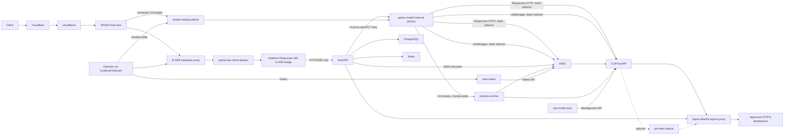

# Architecture

Component graph and responsibility split of the gateway stack.

> [!IMPORTANT]
> This project lets you build an AI gateway that is entirely your own, one module at a time. The architecture combines the strengths of each module and covers their weaknesses, so you are not limited by any single gateway or component, and you do not need large-scale custom development.

> [!NOTE]
> Have an AI deploy this project for you. Its maintainability relies on AI-native development:
>
> 1. Components are cleanly separated, so humans can easily review the architecture and check that the configuration is correct.
> 2. No automated deployment script hides or unifies the complexity of the configuration files. Let an AI make configuration changes for you, so that nothing is changed incorrectly or missed.

Model inventory synchronization: [cpa-model-sync usage and policy migration](../cpa-model-sync/README.md).
The Rust sidecar manages only the five supported API-key kinds through CPA's internal
Management API. Gemini/Interactions retain their existing inventory behavior; models-enricher metadata,
OAuth/native visibility, static aliases and downstream authorization remain separate.

Reusable Docker Compose stack for [CLIProxyAPI](https://github.com/router-for-me/CLIProxyAPI), [Sub2API](https://github.com/Wei-Shaw/sub2api), [AISIX](https://github.com/api7/aisix), [Apache APISIX](https://apisix.apache.org/), [ai-sse-keepalive-proxy](https://github.com/xz-dev/ai-sse-keepalive-proxy), [openai-api-cache-keeper](https://github.com/xz-dev/openai-api-cache-keeper), [Squid](https://www.squid-cache.org/), [socat](http://www.dest-unreach.org/socat/), and [Cloudflare Tunnel](https://developers.cloudflare.com/cloudflare-one/networks/connectors/cloudflare-tunnel/).

It separates provider credentials, client API-key authority, logical-model routing, public routing, and Internet ingress:

