# Architecture

Component graph and responsibility split of the gateway stack.

> [!IMPORTANT]
> This project lets you build an AI gateway that is entirely your own, one module at a time. The architecture combines the strengths of each module and covers their weaknesses, so you are not limited by any single gateway or component, and you do not need large-scale custom development.

> [!NOTE]
> Have an AI deploy this project for you. Its maintainability relies on AI-native development:
>
> 1. Components are cleanly separated, so humans can easily review the architecture and check that the configuration is correct.
> 2. No automated deployment script hides or unifies the complexity of the configuration files. Let an AI make configuration changes for you, so that nothing is changed incorrectly or missed.

Model inventory synchronization: [cpa-model-sync usage and policy migration](../services/cpa/cpa-model-sync/README.md).
The Rust sidecar manages only the five supported API-key kinds through CPA's internal
Management API. Gemini/Interactions retain their existing inventory behavior; model-catalog metadata,
OAuth/native visibility, static aliases and downstream authorization remain separate.

Reusable Docker Compose stack for [CLIProxyAPI](https://github.com/router-for-me/CLIProxyAPI), [Sub2API](https://github.com/Wei-Shaw/sub2api), [AISIX](https://github.com/api7/aisix), [Apache APISIX](https://apisix.apache.org/), [ai-sse-keepalive-proxy](https://github.com/xz-dev/ai-sse-keepalive-proxy), [openai-api-cache-keeper](https://github.com/xz-dev/openai-api-cache-keeper), [Squid](https://www.squid-cache.org/), [socat](http://www.dest-unreach.org/socat/), and [Cloudflare Tunnel](https://developers.cloudflare.com/cloudflare-one/networks/connectors/cloudflare-tunnel/).

It separates provider credentials, client API-key authority, logical-model routing, public routing, and Internet ingress:

```mermaid
flowchart LR
  Client --> Cloudflare
  Cloudflare --> cloudflared
  cloudflared --> APISIX[APISIX front door]
  APISIX --> Keepalive[AI SSE keepalive proxy]
  Operator[Operator via localhost/Tailscale] --> Keepalive
  Keepalive --> Keeper[openai-api-cache-keeper]
  Keeper --> Bridge[stateless Responses WS to SSE bridge]
  Bridge -->|HTTP/SSE only| Sub2API
  Sub2API -->|cli-proxy-api:8317 relay| Models[apisix-models internal APISIX]
  Models -->|all inference, constant pipe| AISIX
  Sub2API -->|AISIX accounts| AISIX
  AISIX -->|exact, glob, then * fallback| CPA[CLIProxyAPI]
  APISIX -->|versioned /v1/models: front-catalog| Models
  Operator -->|:9083 /models-table| APISIX
  APISIX -->|/models-table: front-model-table| Catalog[model-catalog]
  Operator -->|/status| Status
  Models -->|/v1/models| Catalog
  Catalog -->|read-only membership| AISIX
  Catalog -->|Management api-call, read-only| CPA
  Sync[cpa-model-sync] -->|Management API| CPA
  Status[aisix-status] -->|Admin API| AISIX
  Sub2API --> PostgreSQL
  Sub2API --> Redis
  CPA --> Proxy[Squid allowlist egress proxy]
  Sub2API --> Proxy
  CPA -.->|optional| ProviderSidecar[provider-sidecar]
  ProviderSidecar -.-> Proxy
  Proxy --> Providers[Approved HTTPS destinations]
```

## Component groups

The repository groups components by role under [`services/`](../services/README.md):

| Group | Components | Role |
|---|---|---|
| [`firewall/`](../services/firewall/README.md) | front-door APISIX, egress proxy, one-way relays | Everything that admits or denies traffic: public route allowlist, Internet egress allowlist, directed TCP edges |
| [`middleware/`](../services/middleware/README.md) | SSE keepalive, cache keeper, WS/SSE bridge | Request-path helpers between the front door and Sub2API |
| [`sub2api/`](../services/sub2api/README.md) | Sub2API, PostgreSQL, Redis | Client API keys, entitlement and quota |
| [`routing/`](../services/routing/README.md) | apisix-models, AISIX, aisix-status, model-catalog | Model selection, logical-model fallback and the model catalog |
| [`cpa/`](../services/cpa/README.md) | CLIProxyAPI config, cpa-model-sync | Provider credentials, pool execution and channel membership |

## Catalog edges

- The front door answers versioned `GET /v1/models` itself: it intersects Sub2API's entitled list with the enriched catalog, which it reads from `apisix-models` over the two-member `front-catalog` network. See [Model catalog path](catalog.md).
- `apisix-models` routes only `/v1/models` to `model-catalog` (through `apisix-models-catalog-relay`).
- The front door's second listener, port `9083`, is published only on `127.0.0.1` and the Tailscale address. It forwards `/models-table` and `/models-table/refresh` to `model-catalog` over the two-member `front-model-table` network. The public listener (`9080`) never matches these paths.
- `model-catalog` reads CPA (Management API, `api-call`) and AISIX (membership) through the one-way `catalog-cpa-relay` and `catalog-aisix-relay`. It has no Internet egress.
